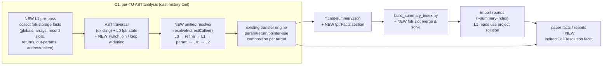
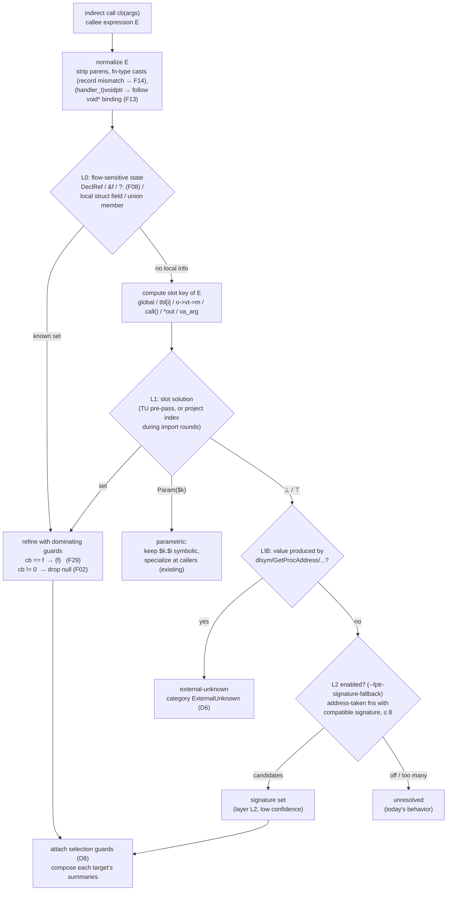
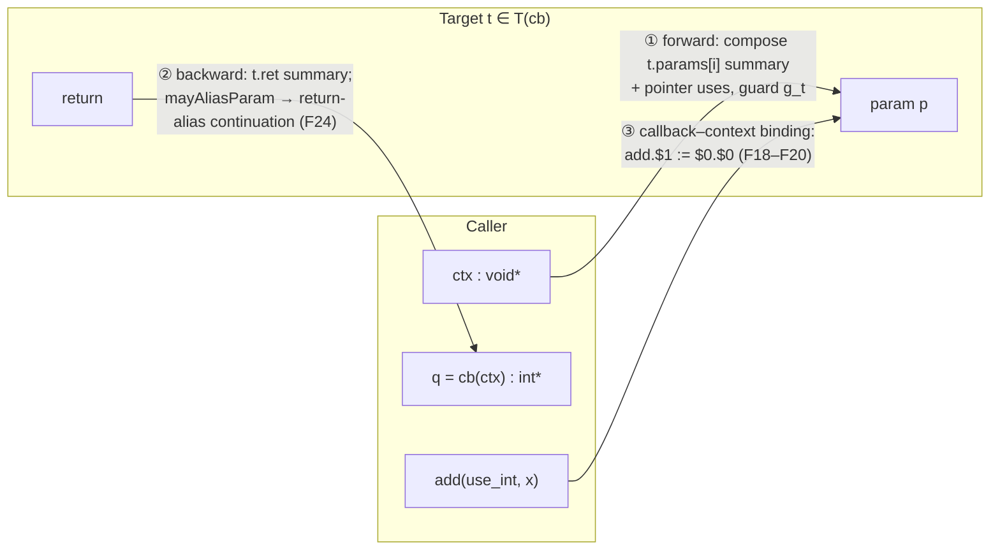
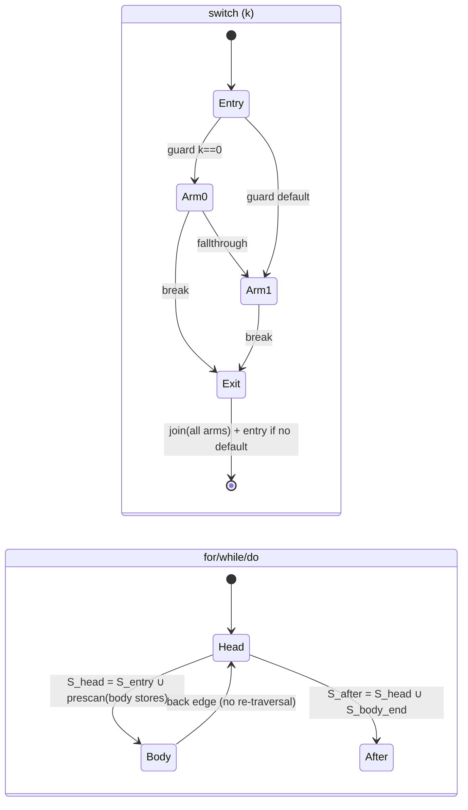

# 02 — fptr extension design

Status: **proposed** — the decisions accepted by the project owner are marked in [03-decisions.md](03-decisions.md).
Scope: how the cast-history analyzer finds function-pointer targets and moves data-pointer evidence across indirect calls, within one TU and across TUs.

## 1. Goals and non-goals

**Goals**
1. Resolve the target set of every indirect call that a `void*` (or other data pointer) flows into. Then compose the targets' parameter, return and pointer-use summaries onto that pointer, as is already done for direct calls.
2. Stay **sound for the modelled program**: a reported target set is a *may*-set. When the analyzer cannot bound it, it says so rather than shrinking it. This fixes F09, F10 and F35.
3. Make resolution quality **visible and countable** through a per-subject `indirectCallResolution` facet that is orthogonal to the 7 primary categories (D1).
4. Keep every step incremental and claimable by fixtures ([04-implementation-plan.md](04-implementation-plan.md)).

**Non-goals:** a general Andersen/Steensgaard points-to analysis for data pointers; CFG-based flow analysis for all state (only fptr state gets control-flow fixes, per D4); C++ virtual calls; dynamic loading beyond reporting (D6).

## 2. Architecture at a glance



The analyzer already has most of the transfer machinery. This includes C3c multi-target import with selection guards (`functionPointerSelectionGuardForTarget`, `CastHistoryVisitor.h:14828`), field-fptr calls (C5*), and same-TU replay (C6d5/C6e1). **The extension adds what is missing in front of it: target discovery.** It also adds a small number of new flow relations.

## 3. Data model

### 3.1 Slots: where an fptr value can live

A **slot key** names a storage location that can hold an fptr, independent of the function currently being analyzed:

| Slot kind | Key (text form used in summaries) | Example | Facts |
|---|---|---|---|
| `local` | `local:<fn>::<var>` | `handler_t cb` | F01 (L0 only, never exported) |
| `global` | `global:<linkage-key>` (`extern` name, or `tu:<file>#name` for `static`) | `g_handler` | F03, F04, F34, F35, X02 |
| `array` | `<base-slot>[*]` (all elements merged) | `table[*]`, `regs[*].fn` | F05, F06, F07, F33, X01 |
| `record` | `record:<canonical record type>.<field path>` | `record:struct ops.read` | F15, F16, F30, X03, X08 |
| `union` | `record:<union type>.<member>`, with all fptr-typed members of one union merged | `record:union action.fn` | F25 |
| `return` | `return:<fn lookup key>` | `return:pick` | F11, F17, X04 |
| `outparam` | `out:<fn lookup key>.$k.*` | `out:get.$0.*` | F12 |
| `param` | `param:<fn>.$k` (symbolic; existing `$k`) | `param:apply.$0` | F31, F04 setter |
| `vararg` | `vararg:<fn>.$...` | `call_with` | F28 |

> **Round 2 (2026-11-25):** the record key rule below is superseded by **D7′** ([03-decisions.md](03-decisions.md)). The key is the *outermost* record visible in the access path, and cast reads union prefix-compatible slots. Evidence: F37 and F42.

**Record slots are object-insensitive** (D7). `o->vt->read` and `p->vt->read` share `record:struct ops.read`. This is the C analogue of a C++ virtual slot: one may-set per (record type, field). Local struct objects still get the existing per-base field state (`functionPointerFieldTargetSets`) as an L0 overlay, so F25/F17-style local precision is not lost.

### 3.2 Target sets

```text
TargetSet  := ⊥                       -- no information yet
            | { TargetRef, ... }      -- may-set, |set| ≤ K (default 16, D11)
            | ⊤(reason)               -- unbounded: escaped slot, dlsym, cap exceeded
TargetRef  := { function lookup key, qualifiedName, signatureKey, isStatic,
                layer ∈ {L0,L1,L2,LIB}, selectionGuard?, provenance }
           |  Param($k)               -- symbolic, specialized at call sites
```

- `join` is set union (guards are or-ed per target). Joining with `⊤` gives `⊤`.
- A **null** source (`0`, `NULL`) contributes no target. It only sets `mayBeNull` (F02).
- A slot becomes `⊤(escaped)` when its address escapes to code that is not analyzed. Examples are `&g_handler` passed to an external function, or a `memcpy` into the slot from an unknown source.

## 4. Resolution at an indirect call site

`resolveIndirectCallee(const Expr *callee)` replaces the ad hoc combination of `resolveFunctionValue` (`:25422`) and `resolveFunctionValueSet` (`:25456`) at call sites. The existing helpers become the L0 step.



### 4.1 Guard policy for multi-target sets (D8)

A multi-target set becomes **guarded** alternatives (`⟨[g1] T1, [g2] T2⟩`, which gives `GuardedActiveReinterpretation`) when the program value that selects the target is visible at the call:

| Selector | Guard text (example) | Facts |
|---|---|---|
| branch / `?:` / `switch` case | `[kind == 0]`, `[!(is_int)]` | F08, F09, X11 |
| table index | `[sel(by_kind[kind & 1]) = use_int]` | F33 |
| object's own slot (vtable) | `[sel(o->vt->read) = use_int]` | F15 |

The set becomes **unguarded** (`UnguardedMultiTargetActiveReinterpretation`) when the selection is *temporal*. That covers loop back edges (F10/X12) and globals mutated elsewhere (F35). In those cases the same object can be passed to different targets over time, with no value at the call that tells them apart.

### 4.2 Resolution facet

Every subject in paper facts and reports gains:

```json
"indirectCallResolution": {
  "state": "none | exact | set | parametric | signature | unresolved | external-modeled | external-unknown",
  "layer": "L0 | L1 | L2 | LIB | -",
  "signatureMismatch": false,
  "sites": [
    {"callee": "table[op & 1]", "slot": "global:table[*]", "state": "set", "layer": "L1",
     "targets": ["use_int", "use_int_neg"], "guarded": false, "composed": true,
     "signatureMismatch": false, "span": {"file": "...", "line": 23, "column": 10}}
  ]
}
```

- `none`: the subject never reaches an indirect call.
- Subject-level `state` is the *weakest* site state, using this order: `unresolved < external-unknown < signature < parametric < external-modeled < set < exact`. `layer` is the highest layer that was needed. The fixture marker form is `resolution=<state>@<layer>`.
- `composed` reports whether a summary was actually transferred. `callbackMediation=Resolved*` can be set even when nothing was composed (F07, F13, F20, F24, F27, F28), so the facet records the truth separately (D12).
- The 7 categories are **not changed** (D1). Aggregators can cross-tabulate `primaryCategory × indirectCallResolution.state`. For example, *OpaqueTransportOrViewOnly ∧ unresolved* means "opaque only because the callee is invisible", while *OpaqueTransportOrViewOnly ∧ exact* means "really opaque".

## 5. Data flow of pointers through indirect calls



1. **Forward (arguments).** For each target `t` with guard `g_t`, compose `t.params[i].obsSummary` and t's pointer-use records onto actual `i`. This is today's C3c path (`applyImportedFunctionPointerTargetSummary`, `:5198`) generalized to every resolved set. Provenance `originKind` becomes `fptr-L0|fptr-L1|fptr-L2|fptr-LIB`.
2. **Backward (returns, out-params).** Compose `t.ret`. If `t.ret.mayAliasParam`, run the *same* return-alias continuation that direct calls use, which fixes F24. If `t` writes through `$k`, apply its out-parameter effects.
3. **Callback–context binding (CCB, D9).** A producer function stores `$a` (fptr) and `$b` (data) into the **same instance** (`regs[n].fn = fn; regs[n].arg = arg;`, or initializer `{fn, ctx}`). A consumer elsewhere calls `X.fn(X.arg)` on the same record type. Together they give the producer the derived higher-order summary `add.$b := $a.$k`. From then on `add(use_int, x)` specializes exactly like `ho(idv, pv)` does today, and **per registration site**, so pairs never cross (F19, X06). If "same instance" cannot be shown syntactically, no binding is derived. The consumer side then falls back to the record slots' cross product (sound but imprecise), and the facet records `binding=weak`.
4. **Library callbacks (LIB, D5).** A curated table describes which argument of a library function is invoked with which data argument (§7). Each row produces a CCB edge at the call. qsort-like rows use an **element-address** relation: the comparator's view is attached to `base` through a pointer-arithmetic step (`base => ⟦+i·size⟧ => const int*`). This reuses the existing `PointerArithmetic` attach path, so the result is F22's `const_int*`.

## 6. Control flow for fptr state (D4)

Only fptr target state (`functionPointerTargets`, `functionPointerTargetSets`, `functionPointerFieldTargetSets`) receives the fixes below. Origin, field and alias state keep the current syntactic behaviour; that is a separate issue.



- **switch.** Snapshot the state at entry. Each `case`/`default` arm starts from entry plus the fallthrough state, with guard `kind == c` (default: the negated disjunction). The state at `break` is collected; the exit state is the join of all collected states. If the switch has no `default`, the entry state is joined as well. Bodies that are not structured (case labels nested in blocks, Duff's device) fall back to `entry ∪ every fptr store in the body`, unguarded, plus an `Approximated` feature record.
- **Loops: pre-scan widening.** Before the single traversal of a loop body, collect every fptr store in the body syntactically, including nested blocks and calls with out-parameters. Resolve each right-hand side with the L0/L1 resolver and seed `S_head = S_entry ∪ stores`. The body is **not traversed twice**, so no cast observation is duplicated. A store whose RHS reads loop-carried state (`s = s.next(ctx)`, F17) is resolved by iterating the return-target relation to a fixpoint over the current set (bounded by K).
- **`?:`.** Expression-level: `set(c ? a : b) = set(a)[c] ∪ set(b)[!c]`.
- **Indirect edges in the call graph.** Every resolved target produces a `SummaryDependencyEdge`, of kind `known-function-pointer-target-call` or `multi-function-pointer-target-call`, with a new `layer` attribute. These edges go into the named-call SCC computation, so recursion closed through a table (F27) reaches a fixpoint.

## 7. Library callback model (LIB, D5)

Data lives in `include/CastHistory/LibraryCallbackModels.def` (X-macro), so adding a row needs no code change:

```c
//          callee           fnArg dataArg  targetParams      relation   kind
LIB_CALLBACK(pthread_create,  2,    3,      LIB_PARAMS(0),    direct,    thread)
LIB_CALLBACK(thrd_create,     1,    2,      LIB_PARAMS(0),    direct,    thread)
LIB_CALLBACK(qsort,           3,    0,      LIB_PARAMS(0, 1), element,   compare)
LIB_CALLBACK(qsort_r,         3,    0,      LIB_PARAMS(0, 1), element,   compare)  // + data #4 -> param 2 (glibc)
LIB_CALLBACK(bsearch,         4,    1,      LIB_PARAMS(1),    element,   compare)  // key #0 -> param 0
LIB_CALLBACK(on_exit,         0,    1,      LIB_PARAMS(1),    direct,    exit)
LIB_CALLBACK(dl_iterate_phdr, 0,    1,      LIB_PARAMS(2),    direct,    iterate)
LIB_NO_DATA (atexit, 0)   LIB_NO_DATA (signal, 1)   LIB_NO_DATA (pthread_once, 1)
LIB_FPTR_SOURCE(dlsym)    LIB_FPTR_SOURCE(dlvsym)   LIB_FPTR_SOURCE(GetProcAddress)
```

- A row matches by callee name **only when the callee has no definition in the project**. A project that defines its own `qsort` keeps using its own body; `examples/qsort.c` is the regression guard.
- `LIB_NO_DATA` rows let the callback count as `external-modeled` instead of `unresolved` (N1).
- `LIB_FPTR_SOURCE` marks values as `⊤(external)`. `dlsym(lib, "name")` with a literal that matches a project function is recorded as a `nameHint` candidate. It is never composed (D6, X10).

## 8. Cross-TU (X01–X13)

```mermaid
sequenceDiagram
  participant A as a.c (C1)
  participant B as b.c (C1)
  participant I as build_summary_index.py
  participant A2 as a.c (import round)
  A->>I: fptrFacts: reads slot global:table[*] at run();<br/>indirect site with arg ctx
  B->>I: fptrFacts: slot global:table[*] ⊇ {use_int, use_int_neg}<br/>+ param summaries of targets
  Note over I: merge slots by key (extern by name,<br/>static by tu-qualified key, record by type key)<br/>solve param-source constraints:<br/>slot ⊇ setter.$0, setter(use_int) ⇒ slot ⊇ {use_int}
  I->>A2: fptrSlotSolution + target summaries
  A2->>A2: resolveIndirectCallee → L1 hit;<br/>compose use_int / use_int_neg onto ctx
```

New compact-summary section (`cast-history-tu-link-summary`, additive):

```json
"fptrFacts": {
  "slots": [{"slot": "global:table[*]", "targets": [{"lookupKey": "...", "isStatic": false}],
             "paramSources": [{"function": "set_handler", "paramIndex": 0}],
             "escaped": false}],
  "returnTargets": [{"function": "pick", "targets": [...], "paramSources": []}],
  "outParamTargets": [{"function": "get", "paramIndex": 0, "targets": [...]}],
  "callbackBindings": [{"function": "add", "fnParam": 0, "dataParam": 1, "targetParam": 0,
                        "strength": "same-instance"}],
  "addressTakenFunctions": [{"lookupKey": "...", "signatureKey": "fn:(ptr:void)->int"}]
}
```

- **Index solve.** Union slots across TUs by key, then iterate to a fixpoint `slot ⊇ param:f.$k` for every call `f(actual)` whose actual resolves. The call edges are already in the index as `SummaryDependencyEdge`s. Complexity is O(edges × K).
- **Statics (X04).** Targets carry the TU-qualified lookup key that the index already uses for static functions (see `p04_static_same_name`).
- **Rounds.** Slot facts depend only on C1 summaries, so one import round resolves direct cases. Chains such as a setter that forwards to another setter converge within `SUMMARY_IMPORT_ROUNDS` (the default of 2 covers every X fixture).

## 9. Soundness, precision, cost

| Concern | Handling |
|---|---|
| Strong update deletes reachable targets (F09, F10, F35) | switch join, loop pre-scan, and L1 instead of initializer for globals |
| Escaped slots | `⊤(escaped)` → `unresolved` with a reason; never a silent shrink |
| Object-insensitive record slots over-merge | the layer tag shows it; K cap; L0 per-object overlay where available |
| L2 signature noise | off by default, capped at 8, always tagged `L2`, reported separately in aggregates |
| Pair crossing (F19) | CCB composes per registration site; weak bindings are reported |
| Order dependence (F34) | the L1 pre-pass runs before any function traversal |
| Cost | pre-pass is O(AST); sets ≤ K; index solve O(E·K); no body re-traversal |

## 10. Touch points (for implementers)

| Area | File / symbol |
|---|---|
| L0 state, merge | `CastHistoryVisitor.h` `functionPointerTargets` (`:24088`), `recordFunctionPointerBinding` (`:25334`), `mergeFunctionPointerStates` (`:25352`) |
| Expression resolver | `resolveFunctionValue` (`:25422`), `resolveFunctionValueSet` (`:25456`), `stripFunctionValueCasts` (`:24980`) |
| Control flow | `TraverseSwitchStmt` (`:3221`), `TraverseFor/While/DoStmt` (`:3231`–`:3259`), `TraverseConditionalOperator` (`:3261`), per-function save/restore (`:1877`) |
| Transfer | `recordCrossTUFunctionPointerCallLookup` (`:5553`), `recordCrossTUFunctionPointerTargetSetLookup` (`:5377`), `applyImportedFunctionPointerTargetSummary` (`:5198`), `functionPointerSelectionGuardForTarget` (`:14828`) |
| Higher-order binding | `resolveHigherOrderBindingForSnapshot` (`:25541`) |
| Call graph | `SummaryDependencyKind` (`AnalysisState.h:298`), `recordKnownFunctionPointerTargetSummaryDependency` (`:1700`) |
| Reporting | `paperSubjectJson` (`:21276`), `paperPrimaryCategory` (`:21200`), `computeCallbackMediationState` (`HistoryMetrics.h:2814`), `schemas/cast-paper-facts.schema.json`, `schemas/cast-summary.schema.json` |
| Index | `scripts/build_summary_index.py` (new fptr slot merge/solve), `scripts/validate_*` |
| New | `include/CastHistory/FptrResolution.h` (slot keys, TargetSet, resolver), `include/CastHistory/LibraryCallbackModels.def` |

Do not grow `CastHistoryVisitor.h` (already over 32k lines) with the new data model. Put it in `FptrResolution.h` and call it from the visitor.

**Round 2:** these touch points are narrowed to the seams S1–S8 in [06-backbone-contract.md](06-backbone-contract.md) (D17). That contract wins where the two disagree. It adds one item missing here: `TraverseIfStmt` must snapshot and merge `functionPointerTargetSets` (F36, seam S5).
