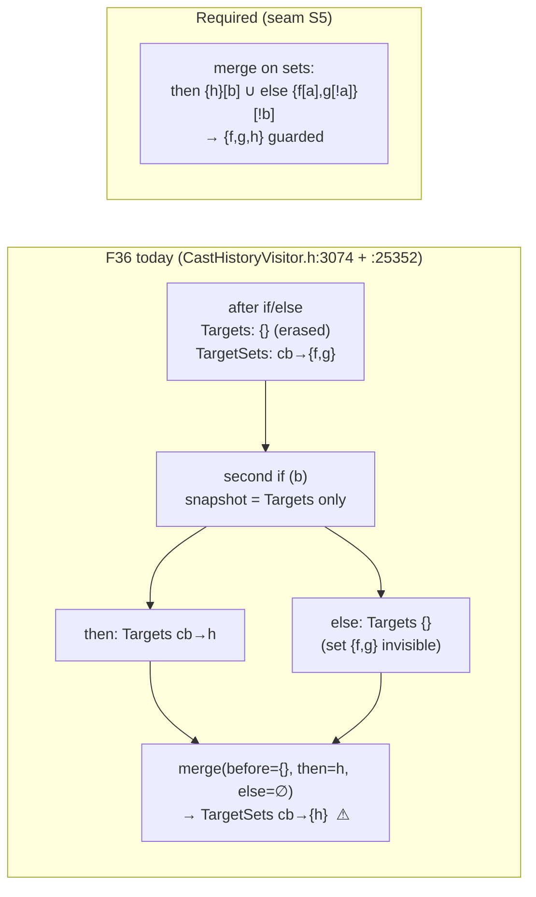
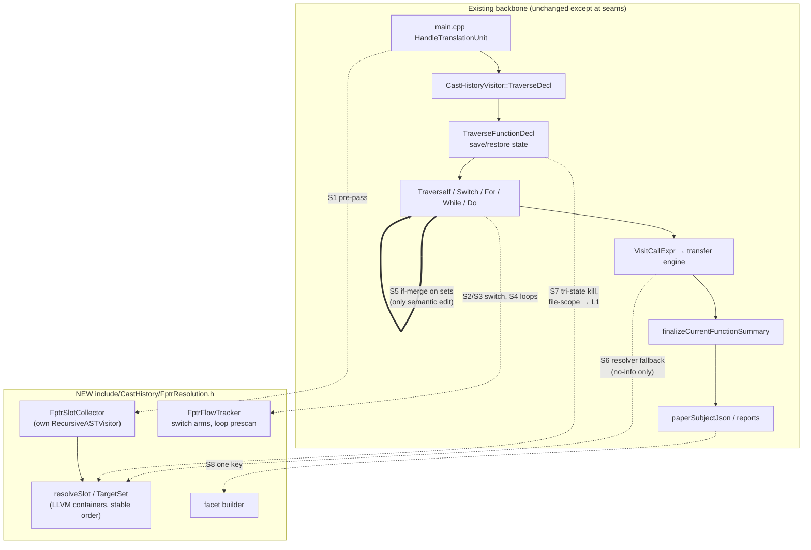
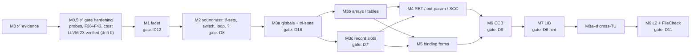
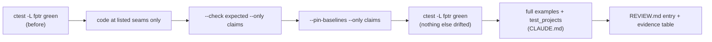

# 05 — Plan review, round 2 (2026-11-25)

**Question:** is the incremental, gated plan in [04-implementation-plan.md](04-implementation-plan.md) solid enough to hand to agents milestone by milestone? Does it preserve the existing `CastHistoryVisitor` backbone?

**Short answer:** the *direction* is solid, but the plan was **not yet safe to hand over**. Two measured soundness defects were missing, the gate itself was broken, and three design points would have produced wrong answers once implemented. All of these are now either fixed (gate), pinned as fixtures (F36–F43), or recorded as decisions to take (D7′, D17–D21). The backbone question is answered by an explicit contract: [06-backbone-contract.md](06-backbone-contract.md).

Everything below was measured on this branch with the llvm-18 build. Re-check with:

```bash
python3 scripts/check_fptr_evidence.py --check baseline     # 56 fixtures, 65 subjects, drift 0
(cd build && ctest -L fptr --output-on-failure)            # same check, through ctest
```

## 1. What holds up

| Strength | Why it matters |
|---|---|
| Evidence first (D10): every fact is a fixture with a pinned `@baseline` and a required `@expected` | a milestone is a list of fixtures that must flip, so it is objectively done or not |
| "Only claimed fixtures may change" rule | regressions and accidental improvements both surface as review items |
| Facet instead of an 8th category (D1) | no schema-breaking change; coverage can be counted separately |
| Layer tag on every target (D2) | reviewers can filter low-confidence results |
| Code anchors in 02-design §10 | all verified at HEAD: `TraverseFunctionDecl :1850`, `TraverseIfStmt :3074`, `TraverseSwitchStmt :3221`, loops `:3231–3259`, `?: :3261`, `resolveFunctionValue :25422`, `resolveFunctionValueSet :25456`, `mergeFunctionPointerStates :25352`, `recordFunctionPointerBinding :25334`, `paperSubjectJson :21276` |
| M2 (soundness) ordered before coverage | wrong answers get fixed before new answers are added |

## 2. Findings

### G — gate and process

| # | Finding | Status |
|---|---|---|
| G1 | The checker globbed `examples/fptr-*.c` and aborted on the first marker-less file. The owner's untracked probes (`fptr-1.c`, …) therefore stopped the whole gate. | **Fixed in M0.5.** Probes were moved to `examples/probes/`, and discovery now names stray files instead of failing on markers. |
| G2 | The fptr gate was not in ctest, although CLAUDE.md says "run ctest". | **Fixed in M0.5:** test `fptr-baseline`, label `fptr`. |
| G3 | **LLVM version skew.** fptr pins come from 18.1.3, `examples/expected/meta.info` from 20.1.2, and CLAUDE.md asks for 19+. On this host `/usr/bin/llvm-config → /etc/alternatives/llvm-config → /opt/llvm-23/bin/llvm-config`, but `/opt` is not mounted in the agent's shell (the link dangles), so `build/` is configured with `/usr/lib/llvm-18`. | **Resolved 2026-11-25.** Built on LLVM 23.1.4: fptr drift 0, so no re-pin was needed. Version recorded in `examples/fptr-meta.info`. Three portable build fixes were required (REVIEWING.md §LLVM). |
| G4 | Marker checks are coarse (category, types, callback, behavior). Other output drift in fptr fixtures is invisible. | Proposed in D19: add the fptr fixtures to the `regress.py` full-output set at M1, so reviewers see a text diff. |
| G5 | Seven of the eight owner probes do not compile as C. Their `.history` files describe a recovered AST. | Probes kept byte-identical; their ideas were rewritten as valid fixtures F37–F41 ([probes README](../../examples/probes/README.md)). |

### B — semantics (would have produced wrong answers)

| # | Finding | Evidence | Resolution |
|---|---|---|---|
| **B1** | **Unsound branch join.** `if (a) cb=f; else cb=g; if (b) cb=h;` keeps only `h`. | **F36**: `long*` only | `TraverseIfStmt` snapshots only `functionPointerTargets`, not `functionPointerTargetSets`, and the merge reads single-target maps. Fix at seam **S5** in M2. |
| **B2** | **D7 over-merges nested records.** `record:struct ops.fn` merges `X.o.fn` and `Y.o.fn`. | **F37** (expected: int* and double* separately) | **D7′:** key by the outermost record visible in the access path. |
| **B3** | **D7 misses aliasing through casts.** A read through `(struct base *)` hits a slot with no stores. | **F42** | D7′: a cast-read unions every slot whose record has a compatible prefix; otherwise ⊤ → `unresolved`. |
| **B4** | **L0 conflates "no info" with "killed".** `recordFunctionPointerBinding` erases in both cases, so a naive L1 fallback would bring back stale targets. | **F43** (`run_local` correct today and must stay so; `run` unsound like F35) | **D18:** L0 tri-state `known / killed-unknown / no-info`; L1 is consulted only on `no-info`. |
| B5 | Address-ordered `std::set<const FunctionDecl*>` | `:24088` | **D21:** new sets order by a stable key (lookup key, then source location). |



### P — plan shape

| # | Finding | Resolution |
|---|---|---|
| P1 | M3 claims 13 fixtures and M8 claims 11, too many for one review. | **D20:** split M3 → M3a globals, M3b arrays/tables, M3c record slots; M8 → M8a–d. |
| P2 | Six owner questions (REVIEW §6) have no gate; M2 would hard-code D8 without sign-off. | **D20:** each milestone row has an *owner gate*; an agent stops if the gate is not met. |
| P3 | Touch points are listed, but there is no limit on *how much* of the visitor a milestone may change. | **D17** + [06-backbone-contract.md](06-backbone-contract.md): eight seams, a forbidden list, and a diff budget. |
| P4 | The controls (F01, F02, F14, F25, F31 and now F38–F41) only become "met" when the facet exists. | They are claimed by M1. Their category and types are already right and are guarded by `@baseline`. |

## 3. Architecture options for preserving the backbone

The visitor is 32 128 lines, and fptr state is threaded through `TraverseFunctionDecl`, `TraverseIfStmt` and the call transfer code. Four options were considered:

| Option | Backbone impact | Soundness | Reviewability | Verdict |
|---|---|---|---|---|
| **(a) Grow the visitor in place** (as 02-design §10 implicitly allowed) | high: edits spread across many functions | as designed | poor: diffs land in a 32k-line file | rejected |
| **(b) Seam extension**: new logic in `FptrResolution.h`, called from eight named seams | low: ≤ ~15 lines per seam, one existing function semantically changed (S5) | as designed | good: every backbone line is accounted for in the PR | **recommended (D17)** |
| (c) CFG-based fptr dataflow on `clang::CFG` | medium: needs a CFG per function and a mapping to the visitor's guard text | best (real joins, loops, `goto`) | medium: new paradigm, duplicated guard logic | fallback if S2–S4 prove fragile on bench code |
| (d) Post-pass over emitted summaries only | none | cannot see L0 or guards; F36/F09/F10 unfixable | good | rejected for L0; **used** for cross-TU (M8, `build_summary_index.py`) |



Why (b) is enough: the existing visitor already overrides every control-flow node the extension needs (`TraverseSwitchStmt` etc. today only record an `Approximated` feature and delegate). The extension adds calls *around* the delegation and never replaces it, so traversal order, observation counts and non-fptr state are unchanged by construction. The one exception is **S5**: B1 is a defect *in* the backbone's existing fptr merge, and fixing it in place is cheaper and more honest than shadowing it.

## 4. Remaining challenges (for discussion)

1. **Switch arms without a CFG (S3).** Case labels nested in blocks, fallthrough into labels, and Duff's device. Plan: detect non-structured bodies and fall back to `entry ∪ all stores`, unguarded, plus an `Approximated` feature record. If bench runs show this fallback firing often, switch to option (c) for switches only.
2. **Loop prescan (S4) and loop-carried RHS.** `s = s->next(ctx)` (F17) needs the return-target relation to a fixpoint. Bounded by K, but it is the first place where cost can grow. Measure it on bench-3c at M4.
3. **D8 guard policy decides category counts.** "Guarded" vs "unguarded" changes `GuardedActive…` vs `UnguardedMultiTarget…` in every aggregate. It needs owner sign-off before M2 (owner gate).
4. **D7′ precision vs soundness.** Outermost-path keys are precise. The cast rule (F42) can widen sets considerably in GObject-style code. The facet's `L1` tag and the K cap bound the damage; measure on icecast/libarchive.
5. **Non-fptr state has the same switch/loop issue** (C4). Out of scope by D4; it should be its own issue.
6. **Facet rollout (M1) touches every paper-facts subject.** Plan: add the key to paper facts only, and leave the text report unchanged in M1, so `regress.py` text diffs stay empty.
7. **LLVM re-pin.** Done: LLVM 23.1.4 gives the same fptr baselines as 18. `regress.py` project expected files (from 20.1.2) differ on 23 only in line *order* (content identical when sorted; JSON identical; stable run to run on one binary) and in the recorded `-resource-dir`. Order that depends on the build is D21 evidence. Regenerating them is a decision for the regress harness (regression-testing.md), not for this extension.

## 5. Revised milestone flow



Per-milestone gate (unchanged in spirit, now enforced by ctest):



## 6. Owner discussion (this round)

| Topic | Owner answer | Consequence |
|---|---|---|
| The 8 untracked probes | Move the originals to `examples/probes/`; add corrected, marker-carrying copies as F36+ only if they add something not already covered | done: F37–F41 come from the probes, F36/F42/F43 from the review; mapping in `examples/probes/README.md` |
| Struct probes calling `s.fn()` with no argument | "Depends on the example: could be the sibling member or self. Is a separate `void* ctx` well supported?" | Yes, the separate ctx (`ops->cb(ctx)`) is the most common idiom. All three readings are fixtured (sibling: F18/F20, self: F16, separate ctx: F15/F30/F37/F40/F41). |
| LLVM version | "LLVM 23 is available, show me how you checked." | How it was checked: `llvm-config` is not on the agent's PATH; `/usr/lib` has llvm-14/18; `build/CMakeCache.txt` has `LLVM_DIR=/usr/lib/llvm-18/cmake`; `/usr/bin/llvm-config` → `/etc/alternatives/llvm-config` → `/opt/llvm-23/bin/llvm-config`, and `/opt` does not exist in the agent's shell, even unsandboxed. LLVM 23 therefore existed on the host but not in the agent environment at first. Later access worked: built on 23.1.4, fptr drift 0, all 129 examples and 145 projects pass. |
| Backbone | Preserve the visitor backbone; modify it only when strictly necessary | D17 seam contract; S5 is the only semantic edit to existing code, and it is justified by the F36 bug |
