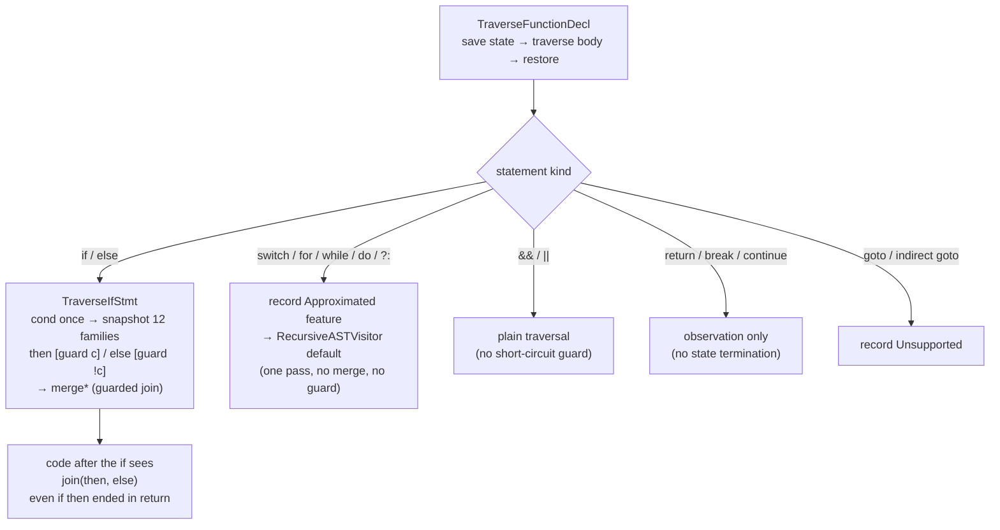
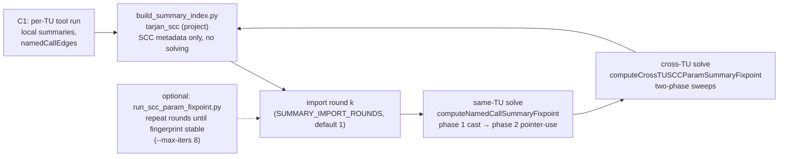

# 07 — The existing engine: control flow, SCCs, fixpoints

What the analyzer on `main` (= `codex/main`, `1e0a393e`) actually does, checked against the code on 2026-11-25 (review round 3). Earlier documents described control flow loosely ("walks the AST once", "no CFG"); this page is the precise reference. Implementers should read it before touching seams S2–S7 or S9.

Anchors are greppable function names in `include/CastHistory/CastHistoryVisitor.h` (V) unless a path is given. Line numbers drift; names do not.

## 1. Summary

| Question | Answer |
|---|---|
| Is a CFG built? | **No.** No `clang/Analysis/CFG.h`, no basic blocks, no successor lists. `ParentMapContext` is used only by `pointerUseKindForArraySubscript` (read/write direction of `a[i]`). |
| How is intra-procedural flow modelled? | **AST-structured, if/else only.** `TraverseIfStmt` snapshots and merges 12 state families. Every other construct is traversed once, in AST order. |
| Are there SCCs? | **Yes, two Tarjans.** Same-TU: `buildSameTUNamedCallSCCWorklistPlan` over `namedCallEdges`. Project: `tarjan_scc` in `scripts/build_summary_index.py` over `SummaryDependencyEdge`s. |
| Are there fixpoints? | **Yes, inter-procedural only.** Same-TU two-phase SCC worklist; cross-TU two-phase sweep; optional external driver over import rounds. |
| What guarantees termination? | **Hard caps**, backed by monotone semantic-fact membership and idempotent widening tokens. Fact enumeration fails open on truncation, so the caps are the real guarantee. |
| Are indirect calls in the SCCs? | **Partly.** Resolved *field* fptr calls and imported fptr-target transfers become `namedCallEdges`. Resolved *local-variable* fptr calls do not. Unresolved calls create no edge at all. |

## 2. Intra-procedural flow (no CFG)



- **State families merged at `if`:** `valueFlows`, `originState`, `fieldOriginState`, `fieldValueFlows`, `aliasParentState`, `pointerStorageAliases`, `structPointerObjectAliases(+FieldPaths)`, `localValueSelfPaths(+TransferTokens)`, `functionPointerTargets`, `functionPointerFieldTargetSets`. (`functionPointerTargetSets` is **not** snapshotted: the F36 bug.)
- **Guards** are text (`Guard{text, kind}` in `HistoryIR.h`). They are pushed only by `TraverseIfStmt`, and nested guards are conjoined as text. Guards are never evaluated, and infeasible combinations are not pruned.
- **Loops:** the body is traversed exactly once. No state family gets a back-edge or zero-iteration join (F10, X12 for fptr state).
- **switch:** arms are traversed in sequence, and the last store wins (F09, X11).
- **Early exits (new, F44):** `return`/`break`/`continue` do not terminate the branch state. After `if (x) { cb = g; return cb(a); }`, the code that follows still sees `g` under `[x]`.

  ```c
  h_t cb = use_int;
  if (x) { cb = use_dbl; return cb(a); }
  return cb(b);   // today: b => ⟨[always] use_int, [x] use_dbl⟩   (use_dbl is infeasible here)
  ```
  This is imprecise, not unsound: the join is a superset.
- **fork-arm / "simple paths"** (`build_summary_index.py`, `SummaryIndex.h` `forkArmProvenance`) are paths over the inter-procedural SCC transfer-edge graph, not over statements.

## 3. Inter-procedural SCCs and fixpoints



| Solver | Where | Order | What grows | Cap | Termination reported |
|---|---|---|---|---|---|
| same-TU phase 1 (cast histories) | `computeNamedCallSummaryFixpoint` | Tarjan components callee-first; FIFO worklist per SCC | parameter `obsSummary` | `edges × MaxNamedCallSummaryIters` (= 16) edge executions, for the whole phase | text only: `scc-worklist-quiescent`, `cast-scc-worklist-execution-limit`, `scc-component-schedule-stalled`, … |
| same-TU phase 2 (pointer uses) | `computeNamedCallPointerUseSCCFixpoint` | same schedule; runs only if phase 1 was quiescent; never reopens phase 1 | parameter pointer uses | same budget; witnesses capped at 4 | text only: `pointer-use-scc-worklist-quiescent`, `…-execution-limit`, `skipped-…` |
| cross-TU two-phase | `computeCrossTUSCCParamSummaryFixpoint` | round-robin sweeps over project SCC edges | same two domains, with separate membership | 16 sweeps per phase | text **and** JSON (`emitCrossTUSCCParamFixpointJson`): `converged`, `iterations`, `note` (`two-phase-converged`, `cast-history-iteration-limit`, …) |
| import rounds | `scripts/run_all_multitu_projects.sh` | fixed count | index | `SUMMARY_IMPORT_ROUNDS` (default **1**) | none (fixed count) |
| external driver | `scripts/run_scc_param_fixpoint.py` | repeated rounds | recursive-function parameter fingerprints | `--max-iters` 8 | report JSON `converged`; exit 2 if not converged |

- **Monotonicity:** a candidate is accepted only if it adds a semantic fact (`recursiveSCCCastCandidateAddsSemanticFact`; project variant `projectSCCCastCandidateAddsSemanticFact`). Recursive edges inside `if` conditions get one idempotent widening token (`applyRecursiveConditionWidening`).
- **Caps are not configurable** (no CLI option). Hitting a cap is reported, and the summaries are then approximations.
- **Observability gap (G6):** the same-TU termination reason is printed in the text report but not emitted in any JSON.

## 4. Indirect calls and the SCC graph (measured)

| Indirect call form | Becomes a `namedCallEdge`? | Recorder | Probe result |
|---|---|---|---|
| resolved field fptr call `o.f(…)` | yes | `recordSameTUFieldFunctionPointerNamedCallEdges` | `op_rec` is `[recursive]` |
| imported fptr-target transfer (cross-TU) | yes | `recordImportedFunctionPointerTargetParamTransferEdge` | — |
| resolved local-variable fptr call `f(…)` | **no** (composed through the separate "same-tu-fnptr" path) | — | `op_rec` is `[acyclic]` |
| unresolved call (`ops[i](…)`, F27) | no edge at all | — | `op_rec` is `[acyclic]` |

Probes (run with `./build/cast-history-tool <file> -- -std=c11 | grep 'SCC #'`):

```c
/* field: recursive SCC */
typedef int (*op_fn)(int, void *); struct ops { op_fn f; };
static int op_rec(int d, void *p) { struct ops o; o.f = op_rec;
  if (d > 0) return o.f(d - 1, p); int *q = p; return *q; }
/* variable: no edge, acyclic */
static int op_rec2(int d, void *p) { op_fn f = op_rec2;
  if (d > 0) return f(d - 1, p); int *q = p; return *q; }
```

Today the variable case still gets the right type, because the composition path handles it directly. It matters once the summary needs an SCC fixpoint, for example when recursion grows the parameter history.

## 5. What the fptr extension reuses vs adds

> **Round 4:** the intra-procedural rows are now served by the CFG solver in [08](08-cfg-fptr-resolution.md); the inter-procedural reuse below stands.

| Need | Reuse | Add |
|---|---|---|
| recursion through resolved targets (F27, F17) | Tarjan (both), two-phase solves, caps, membership, widening | **S9:** record `namedCallEdges` for resolved variable and L1 targets, mirroring the field recorder (additive) |
| switch/loop/early-exit soundness for fptr state | `TraverseIfStmt` snapshot/merge pattern, guard stack | S2–S5 hooks (fptr-only), D23 early exits; option (c) CFG remains the fallback |
| loop-carried fptr (F17) and prescan | the cap convention (`MaxNamedCallSummaryIters`), termination-reason pattern | its own bounded iteration, reported in text **and** JSON, `Approximated` on cap |
| cross-TU slot solving | import rounds, index edges, `tarjan_scc` | D22: where the slot solve runs (C++ in import rounds, or the first solver in the Python index) |
| facet honesty when a cap was hit | termination reasons | future: facet field `fixpoint: converged | capped` (needs G6) |
