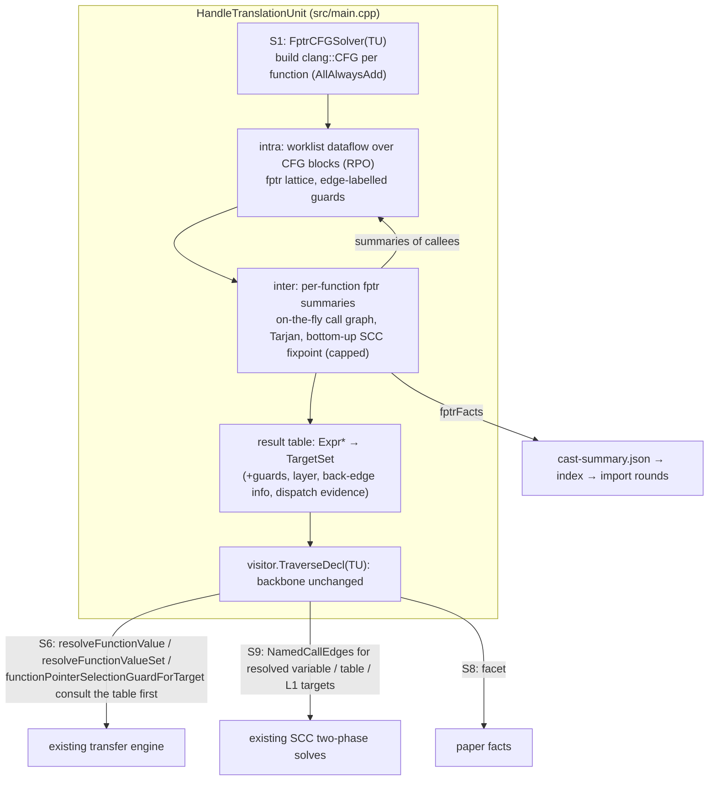
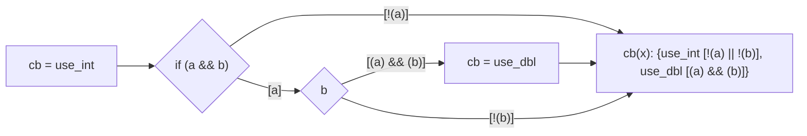
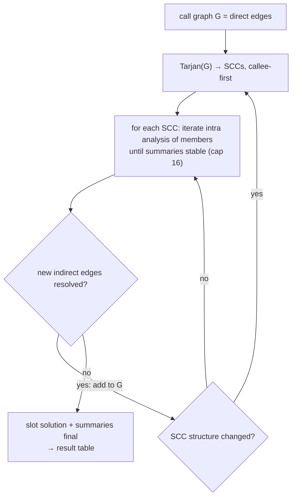

# 08 — CFG-based function-pointer resolution

Status: **proposed** (round 4, 2026-11-25). Decisions D24–D30 in [03-decisions.md](03-decisions.md). It supersedes the AST-patch plan for M2: seams S2–S5, the D15 prescan and the D23 early-exit rule.

**Owner's request:** add a CFG to support **loops > conditions > goto** and their combinations, use it for fptr resolution, and support recursion and cross-TU summary composition.

**Starting point** ([07-existing-engine.md](07-existing-engine.md)):
- No CFG exists, and only `if/else` merges state.
- The inter-procedural side (two Tarjans, capped two-phase fixpoints, import rounds) is mature and is reused.

**Toolchain:** `clang/Analysis/CFG.h` and `libclangAnalysis` ship with LLVM 18 and 23 (already linked transitively).

**Prevalence in bench C code** (5,362 files): 9,204 `goto` statements in 732 files (4 computed), about 38.5k loops, 5.7k switches.

## 1. Evidence: what the missing CFG costs today

Pinned fixtures (fixture before code, D10). "Unsound" means a reachable target is lost.

| Priority | Fixture | Pattern | Today (measured) | With a CFG |
|---|---|---|---|---|
| loops | F10, X12 | target reassigned on a back edge | ⚠️ `int*` only | set, unrelated (§6) |
| loops | **F46** | `while (c) cb = g; cb(y)` | ⚠️ exact `double*`; the zero-iteration path is lost | set |
| loops | F45 | `for(;;){ if(c){cb=g; break;} } cb(x)` | imprecise set | exact `g` |
| loops | F44 | `if (x) { cb=g; return cb(a); } return cb(b);` | imprecise set | exact `f` |
| conditions | F09, X11 | switch arms | ⚠️ last store wins | set |
| conditions | **F47** | switch fallthrough into the call | ⚠️ exact `double*` | set |
| conditions | F36 | one-armed `if` after a merge | ⚠️ last target only | set |
| conditions | F08, F48 | `?:`, `&&` | unresolved / right by accident | guarded set |
| goto | **F50** | backward goto retry | ⚠️ exact `int*` | set, unrelated |
| goto | F49 | forward goto cleanup | right by accident | set |
| combination | **F51** | `for(;;) switch(s){… continue/break/return}` | ⚠️ exact `double*` | set, unrelated |
| recursion | F52, F27 | recursion through a local fptr or a table | unresolved; no SCC edge | exact; S9 edge |
| cross-TU | X14 | b.c loop over `lookup(i)(x)`, a.c `lookup` returns via switch | unresolved | set from a cross-TU return summary |

## 2. Architecture: a TU pre-pass solver beside the visitor



- **No semantic edit to existing visitor code.** The CFG solver runs before the visitor and only *answers queries*.
- **Fallback.** The AST fptr maps (`functionPointerTargets`, …) are kept unchanged. They are used only when a function has no CFG (`buildCFG` fails or unsupported statements are present). In that case an `Approximated` feature is recorded.
- **Seams:** S1 (pre-pass), S6 (three lookups), S8 (facet, done), S9 (edges). Seams S2, S3, S4, S5 and S7 are retired ([06-backbone-contract.md](06-backbone-contract.md)).
- **F36's AST merge defect** remains only on the fallback path. It is counted by the cross-check mode (§9).

## 3. Intra-procedural analysis

### 3.1 Lattice

```text
Value     := ⊥ | {Alt, ...} with |set| ≤ K (16) | ⊤(reason)
Alt       := (target, guard, viaBackEdge)
target    := FunctionDecl | Param($k) | Ret(callsite) | Slot(key)
Location  := local | parameter | local field path (per-object overlay) |
             global (written locally) | *out (out-parameter cell)
State     := Location → Value
```

- **Join** is the union of alternatives. Guards of the same target are OR-ed. `viaBackEdge` is OR-ed.
- **Caps.** Past K targets the value becomes `⊤(cap)`. A guard larger than the cap is dropped, with the reason recorded (it then carries no correlation evidence).
- **Symbolic targets.** `Param($k)` is specialised at call sites by the existing `$k.$i` mechanism. `Slot(key)` is resolved by the TU slot solution (§5). `Ret(callsite)` is resolved from the callee summary (§4).
- **D18 tri-state by construction.** "Killed by an unknown store" is `⊤(unknown)`. "No information" is a symbolic `Slot` or `Param`.

### 3.2 Transfer functions (per CFG element, in evaluation order)

| Element | Effect |
|---|---|
| `T v = e;`, `v = e` | strong update `v := eval(e)` |
| `o.f = e`, `p->f = e` (p local, points to a known local object) | strong update of the field path; otherwise a weak update of the record slot (§5) |
| `*out = e` | update the out cell; becomes the function's out-param effect |
| global `g = e` | local strong update plus a slot contribution `Slot(g) ⊇ eval(e)` |
| direct call `h(args)` | apply h's fptr summary: substitute `Param` with the actuals' values; apply out-param effects; add slot contributions |
| indirect call `p(args)` | join the summaries over `eval(p)`; record the call site's TargetSet in the table |
| `&v` passed to unknown/external code | `v := ⊤(escaped)` |
| fn-type cast | records the cast step in the fptr cast history (§7) |
| `eval(c ? a : b)` | `eval(a)[c] ∪ eval(b)[!c]` |
| `eval(tbl[i])`, `eval(o->vt->m)` | `Slot(array or record key)` (L1) |

### 3.3 Edge labels and guards

The CFG terminators give guards. They are rendered with the visitor's `exprToString`, so the text matches existing guards.



- `if`, `?:`, `&&` and `||` produce true/false edges labelled `[c]` and `[!(c)]`.
- `switch` produces case edges labelled `[k == c]`, and the default edge gets the negated disjunction. Fallthrough is a plain edge, so the fallthrough target joins with the case guard of its origin (F47).
- `goto` and `break`/`continue` produce unlabelled edges.

Guards are **evidence, not the classifier** (§6). They show *how* a target was selected, and `dispatchCorrelation` uses them.

### 3.4 Loops (priority 1)

- **Back edges** are DFS retreating edges over the CFG. This also covers irreducible loops built with `goto` (N10). A value that flows over a back edge is marked `viaBackEdge`.
- **Zero vs at-least-one iteration** follows from the CFG (F46). So do `break`-only exits (F45) and `continue`.
- **What a loop contributes to cast history** is exactly two facts:
  1. **sound target sets**: no reachable target is lost (F10, F46, F50, F51);
  2. **subject persistence across iterations**: whether the *same object* reaches the call on several iterations while the target changes. That decides whether the set is a reinterpretation of one object (§6).

  A target set alone, or "is it guarded", says nothing about history. The loop matters only through these two facts.

### 3.5 Conditions (priority 2) and goto (priority 3)

- **Conditions.** `if`/`switch` (including fallthrough), `?:`, `&&` and `||`. Equality refinement `cb == f` on the true edge narrows `cb` to `{f}` (F29, moved from M5).
- **goto.** Forward gotos (the cleanup idiom, F49), backward gotos (retry, F50) and irreducible regions are all just edges. Computed `goto *p` uses clang's indirect-goto block, which has an edge to every address-taken label (sound).

### 3.6 Termination

- The worklist runs in reverse post-order. Its cap is `MaxNamedCallSummaryIters (16) × #blocks` transfer executions, the engine's convention ([07 §3](07-existing-engine.md#3-inter-procedural-sccs-and-fixpoints)).
- The lattice has finite height (K, the guard cap, ⊤), so the cap is a safety net, not the argument.
- On the cap, values at the affected calls become `⊤(cap)`, so the result is `unresolved`, plus an `Approximated` feature.
- The termination reason (`quiescent | capped`) is reported in text **and** JSON (lesson G6). The facet gains `fixpoint`.

## 4. Recursion

- **Per-function fptr summary:**
  - `ret`: a Value over `FunctionDecl | Param($k) | ⊤`;
  - out-param effects `$k* := Value`;
  - slot contributions `Slot ⊇ Value` (including `Param` sources);
  - indirect sites with their callee Values (`Param` means parametric).



- **Outer cap.** Re-planning is capped at 16 rounds; on the cap, the result is `⊤(cap)` with a recorded reason.
- **Small domain.** The fptr domain is tiny, so this solve runs **before**, and separately from, the cast-history solve. It mirrors `buildSameTUNamedCallSCCWorklistPlan` and `computeNamedCallSummaryFixpoint`.
- **Cast-history recursion through fptr calls** (F27, F52) is then handled by the **existing** two-phase solve. S9 emits `NamedCallEdge`s for resolved variable, table and L1 targets, alongside the existing field recorder.

## 5. L1 slots in the same solver

- **Slots.** Globals, arrays (`[*]`) and record slots (D7′ outermost-path keys) are flow-insensitive. Every function's transfer contributes to them, and they are solved together with the summaries in the §4 fixpoint.
- **Reads inside a function.** A global with no local store reads `Slot(key)`. A local store is a strong update along that path (the D3 overlay).
- **Globals.** F03, F04, F32, F34, F35 and F43 follow by construction.

## 6. What a target set means for cast history: dispatch correlation (D30)

A multi-target set is interesting for cast history only if the targets *view the subject differently* **and** the same object can meet different views. The per-subject facet therefore records the evidence, not only a guard tag:

| `dispatchCorrelation` | Condition | Category effect | Examples |
|---|---|---|---|
| `single-view` | all targets in T view the subject with the same type | Monomorphic (no reinterpretation, however many targets) | two `int*` readers |
| `object-correlated` | the selector derives from the same object passed as the argument (`o->vt->m(o)`, `tbl[o->kind](o->data)`, `switch (o->tag)`), and each object is read and written through the same function | Guarded (safe polymorphism) | F15, F33, **F54** |
| `per-iteration-subject` | the subject is fresh on each iteration (`for (i) tbl[i](objs[i])`) | as per call | — |
| `unrelated` | any other multi-view case: the same object meets different targets over loop iterations (back edge), a selector not derived from the object, or a global mutated elsewhere | UnguardedMultiTarget (real reinterpretation risk) | F10, F35, F47, **F50**, F51, **F55**, X14 |

- **Write consistency.** If two targets *write* the subject with different types (`incompatibleActiveWrites`), the dispatch is `unrelated` unless it is object-correlated.
- **Guards.** Guard text from §3.3 is kept as evidence. A `switch (o->tag)` guard is what proves object correlation.
- **Pushback, recorded.** Guards alone are a proxy, and "unguarded" alone is not an interesting label for fptrs. But guards are not useless: for tag-switch dispatch they *are* the correlation evidence.

## 7. Function-type casts (D29)

The fptr value gets a cast history like data pointers do. The call-time callee type is compared with the target's declared type, and intermediate casts count as transport.

| Label | Example | Flag |
|---|---|---|
| `fnptr-transport` | `use_int : int(*)(void*) => void(*)(void) => int(*)(void*)` (G_CALLBACK idiom, F53); `(void*)f` round trip (F13) | none; resolution `exact` |
| `fnptr-param-variance` | `(handler_t)use_long` called with `void*` where `long*` is declared (F14) | `signatureMismatch=true`, `ubKind=param-type-incompatible` (C17 6.5.2.2p9), with the reason. The argument also gets cast evidence `void* => long*` |
| `fnptr-incompatible` | arity differs (F56), pointer vs scalar, struct by value, used return type differs | `signatureMismatch=true`, `ubKind=signature-incompatible` |

Pointer-parameter variance usually works on common ABIs, but it is UB. It is flagged with its reason so that later UB or multi-platform analyses can select it. Transport-only casts carry no flag.

## 8. Cross-TU composition

```mermaid
sequenceDiagram
  participant A as a.c (C1)
  participant B as b.c (C1)
  participant I as build_summary_index.py
  participant B2 as b.c (import round)
  A->>I: fptrFacts: lookup.ret = {use_int [k==0], use_dbl [default]}
  B->>I: fptrFacts: indirect site in drive: callee = Ret(lookup)
  Note over I: merge by key (no solving; D27)
  I->>B2: lookup's fptr summary + target param summaries
  B2->>B2: FptrCFGSolver: Ret(lookup) → {use_int, use_dbl}<br/>loop back edge + same x → unrelated (X14)
```

- **Export.** `fptrFacts` holds summaries, slot contributions, address-taken functions and indirect sites.
- **Index.** It merges by key and solves nothing (D27). The C++ import round loads the facts and re-solves locally with the same caps.
- **Project call graph.** Resolved indirect edges are emitted as `known-/multi-function-pointer-target-call` `SummaryDependencyEdge`s with concrete keys. The project `tarjan_scc` and the existing cross-TU two-phase solve then compose cast histories across TU recursion.
- **fptr summaries across recursive TU cycles** converge over import rounds. `run_scc_param_fixpoint.py` gains an fptr-summary fingerprint. The default of `SUMMARY_IMPORT_ROUNDS=1` is documented as insufficient for forwarding chains; the fixtures use 2.

## 9. Risks

| Risk | Mitigation |
|---|---|
| two flow models (fptr via CFG, data via AST) disagree | same guard text; `--fptr-cfg-crosscheck` reports CFG vs AST-L0 differences on fixtures and bench |
| guard explosion | guard cap, then drop to no guard evidence, with the reason |
| runtime | one CFG per function plus a small worklist; budget ≤ 10 % on bench-tcc/bench-3c, measured with the runtime sidecars |
| on-the-fly call graph does not converge | inner and outer caps; `fixpoint: capped` in the facet and JSON |
| CFG unavailable for a function | AST L0 fallback plus `Approximated` |

## 10. Alternatives considered

| Option | Verdict |
|---|---|
| AST patches S2–S5 (round-2 plan) | Rejected. Four backbone edits; no goto, no early exits, no irreducible flow; loops only via prescan |
| clang FlowSensitive framework | Rejected. A C++ value model and heavy, while this lattice is tiny. Revisit if data-pointer state (C4) moves to a CFG |
| CFG for all state | Out of scope (D4). The solver's lattice interface stays generic so C4 can reuse it |

## 11. Milestones (see [04](04-implementation-plan.md))

M2a CFG + loops → M2b conditions → M2c goto + combinations → M3 slots in the solver → M4 summaries + recursion (S9) → … → M8 cross-TU (X14).
